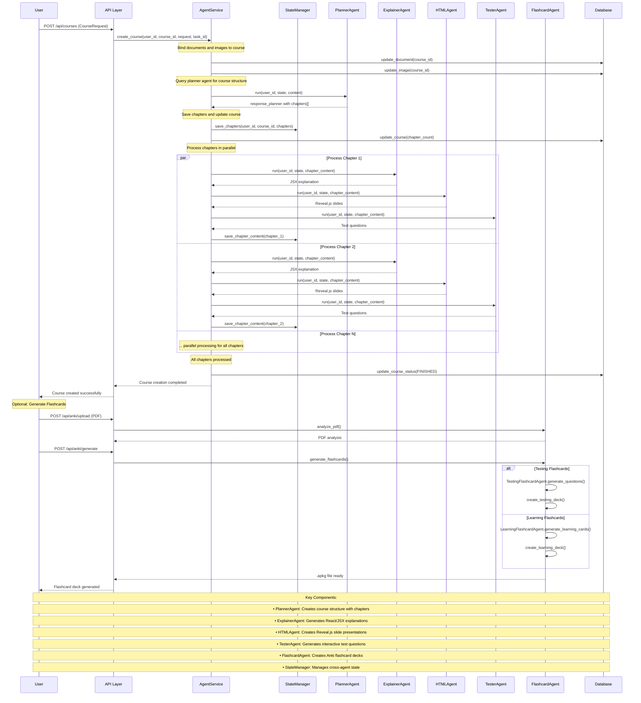

# EduAgent | AI-Powered Learning Platform

An enterprise-ready, asynchronous FastAPI backend powering an AI-driven educational platform. Designed for high-throughput code validation, dynamic content synthesis, and automated learning workflows using Retrieval-Augmented Generation (RAG) and specialized LLM agents.

## 🌟 Key Features

- **Automated Code Analysis**: Multi-stage agent pipeline evaluating syntax, runtime behavior, and style checks (`ESLintValidator` & Python checkers).
- **LLM Agent Orchestration**: Modular service layer managing dynamic prompts, session context, and AI-driven course recommendations.
- **Asynchronous Architecture**: Built on FastAPI and SQLAlchemy for high-concurrency API performance.
- **Modern Package Management**: Optimized for fast dependency resolution and reproducible builds using `uv` (Astral).

## 🛠️ Tech Stack

- **Framework**: FastAPI, Uvicorn
- **Language & Runtime**: Python 3.13+
- **Database & ORM**: PostgreSQL / SQLite, SQLAlchemy
- **AI/LLM Stack**: Google GenAI SDK, Custom Agent Pipelines
- **Tooling & Packaging**: `uv`, Docker, Pytest

## Technical Diagram



## Getting Started

### 1. Clone the repository

```sh
git clone <repo-url>
cd edu-backend
```

### 2. Set up environment variables

Create a `.env` file in the root directory with at least:

```text
DB_USER=your_db_user
DB_PASSWORD=your_db_password
DB_HOST=localhost
DB_PORT=3306
DB_NAME=your_app_db
SECRET_KEY=your_secret_key
SESSION_SECRET_KEY=your_session_secret
ACCESS_TOKEN_EXPIRE_MINUTES=20
REFRESH_TOKEN_EXPIRE_MINUTES=360000
SECURE_COOKIE=true
# OAuth keys (Google, GitHub, Discord)
GOOGLE_CLIENT_ID=...
GOOGLE_CLIENT_SECRET=...
GITHUB_CLIENT_ID=...
GITHUB_CLIENT_SECRET=...
DISCORD_CLIENT_ID=...
DISCORD_CLIENT_SECRET=...
```

### 3. Install dependencies

```sh
pip install -r requirements.txt
```

### 4. Set up the database

- Ensure MySQL is running and the database exists.
- (Optional) For local dev, switch to SQLite by editing `src/config/settings.py`.
- Run migrations or create tables (see Alembic or use SQLAlchemy's `Base.metadata.create_all`).

### 5. Run the server

```sh
uvicorn src.main:app --reload
```

## 🚀 API Endpoints Overview

| Module | Base Path | Description |
| :--- | :--- | :--- |
| **Auth** | `/api/auth` | User authentication, token validation, and session management |
| **Courses** | `/api/courses` | Dynamic course content loading and progress tracking |
| **Code Checker**| `/api/code` | Multi-language code evaluation via localized static checkers |
| **Agents** | `/api/agents` | Explainer & reasoning LLM agent execution pipeline |

## 🏗️ Architecture Overview

```text
[ Client Requests ]
        │
        ▼
[ FastAPI Routers ] ──► [ Auth & Middleware ]
        │
        ▼
 [ Service Layer ] ──► [ LLM / Agent Orchestrator ]
        │                      │
        ▼                      ▼
  [ SQLAlchemy ]      [ Code Checker Engine ]
        │
        ▼
   [ Database ]
